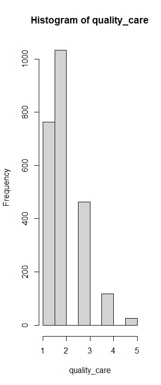
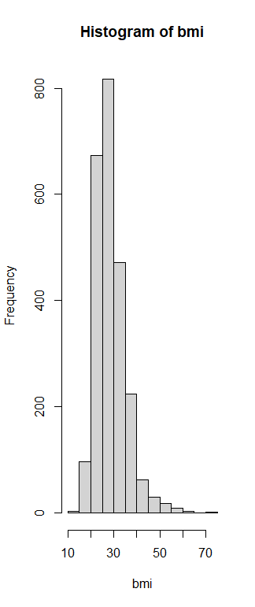
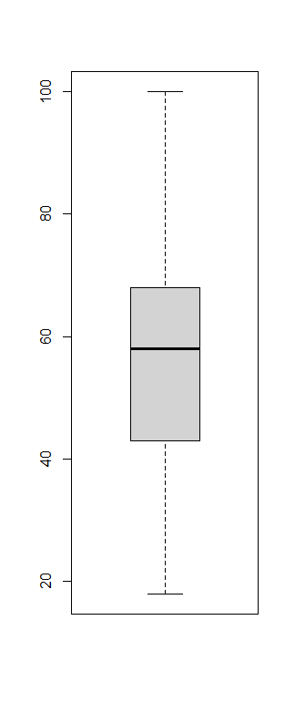
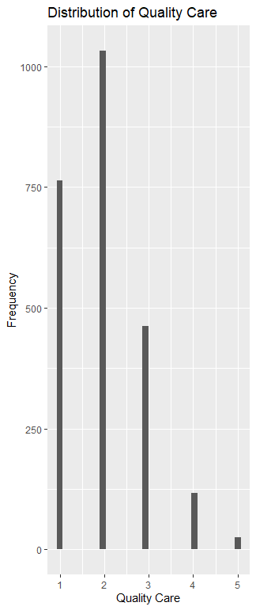
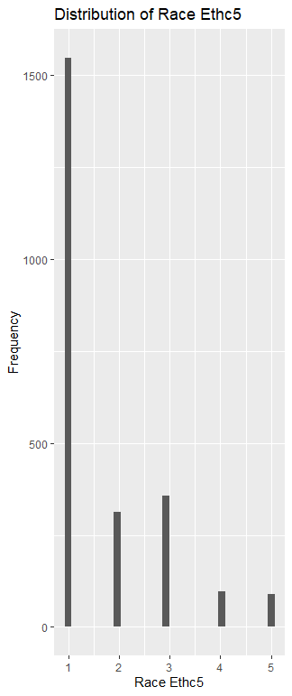
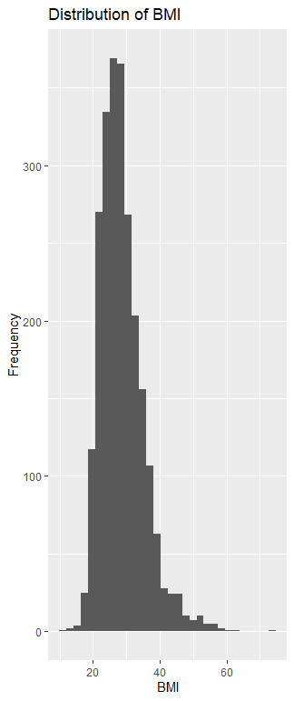
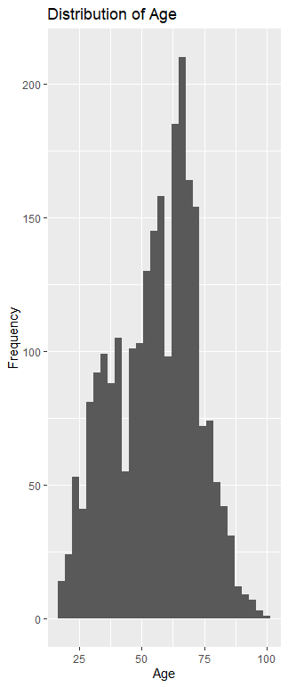

```{r setup, include=FALSE}
knitr::opts_chunk$set(echo = TRUE)
```

# Project Setup & Data Import

```{r, eval=FALSE}
#Installs the dplyr package.
install.packages("dplyr") 
library(dplyr)

#Installs the skimr package.
install.packages("skimr")  
library(skimr)

#Installs the ggplot2 package.
install.packages("ggplot2")
library(ggplot2)

#Reads the uploaded data sheet.
data_name <- read.csv("HINTSData_2020_clean.csv")

#Inspects data sheet for missing values and cleans it if applicable.
summary(data_name)
any(is.na(data_name))
head(data_name)
```

# Data Management & Wrangling

```{r, eval=FALSE}
#Separates specific variables from the data sheet.
age <- data_name$Age
avg_drink_per_week <- data_name$AvgDrinksPerWeek
weekly_minutes_moderate_excercise <- data_name$WeeklyMinutesModerateExercise
bmi <- data_name$BMI
quality_care <- data_name$QualityCare
birth_gender <- data_name$BirthGender
smoke_stat <- data_name$smokeStat
race_ethn5 <- data_name$RaceEthn5
```

# Descriptive Analysis & Function Writing

```{r, eval=FALSE}
#Displays the statistical summaries of mean, median, standard deviation, & variance of each variable.
my_summary_func <- function(data_column) {
  cat("Summary:\n")
  print(summary(data_column))
  cat("\nMean: ", mean(data_column), 
      "\nMedian: ", median(data_column), 
      "\nStd. Dev: ", sd(data_column), 
      "\nVariance: ", var(data_column), "\n")
}
#Provides the summary functions of each variable.
my_summary_func(age)
my_summary_func(avg_drink_per_week)
my_summary_func(weekly_minutes_moderate_excercise)
my_summary_func(bmi)
my_summary_func(quality_care)
my_summary_func(birth_gender)
my_summary_func(smoke_stat)
my_summary_func(race_ethn5)
```

### 1. Age (`age`)

|                        |              |
|------------------------|--------------|
| **Statistical Metric** | **Value**    |
| **Mean**               | 55.59 years  |
| **Standard Deviation** | 16.58 years  |
| **Variance**           | 274.86       |
| **Minimum (Min)**      | 18.00 years  |
| **1st Quartile (25%)** | 43.00 years  |
| **Median (50%)**       | 58.00 years  |
| **3rd Quartile (75%)** | 68.00 years  |
| **Maximum (Max)**      | 100.00 years |

**Interpretation:** The average age of respondents is approximately 55.6 years, with a standard deviation of 16.58 years, indicating a diverse age range from young adults (18) to centenarians (100). The median age of 58.0 and closely aligned quartiles show that half of the participants fall between 43 and 68 years old.

### 2. Average Drinks Per Week (`avg_drink_per_week`)

|                        |              |
|------------------------|--------------|
| **Statistical Metric** | **Value**    |
| **Mean**               | 3.36 drinks  |
| **Standard Deviation** | 6.59 drinks  |
| **Variance**           | 43.40        |
| **Minimum (Min)**      | 0.00 drinks  |
| **1st Quartile (25%)** | 0.00 drinks  |
| **Median (50%)**       | 0.00 drinks  |
| **3rd Quartile (75%)** | 4.00 drinks  |
| **Maximum (Max)**      | 70.00 drinks |

**Interpretation:** On average, respondents report consuming about 3.36 alcoholic drinks per week. However, the median and lower quartiles (0.0) indicate that a majority of respondents report zero weekly consumption, while a right-skewed tail extends up to a maximum of 70 drinks per week. The high standard deviation relative to the mean reflects this skewed distribution.

### 3. Weekly Minutes of Moderate Exercise (`weekly_minutes_moderate_exercise`)

|                        |                  |
|------------------------|------------------|
| **Statistical Metric** | **Value**        |
| **Mean**               | 161.78 minutes   |
| **Standard Deviation** | 271.19 minutes   |
| **Variance**           | 73,543.61        |
| **Minimum (Min)**      | 0.00 minutes     |
| **1st Quartile (25%)** | 0.00 minutes     |
| **Median (50%)**       | 90.00 minutes    |
| **3rd Quartile (75%)** | 210.00 minutes   |
| **Maximum (Max)**      | 4,620.00 minutes |

### 4. Body Mass Index (`bmi`)

|                        |           |
|------------------------|-----------|
| **Statistical Metric** | **Value** |
| **Mean**               | 28.61     |
| **Standard Deviation** | 6.54      |
| **Variance**           | 42.75     |
| **Minimum (Min)**      | 10.90     |
| **1st Quartile (25%)** | 24.00     |
| **Median (50%)**       | 27.50     |
| **3rd Quartile (75%)** | 31.90     |
| **Maximum (Max)**      | 73.80     |

**Interpretation:** The average BMI in the sample is 28.61, placing it near the overweight threshold. The median BMI is 27.5, and the interquartile range spans from 24.0 to 31.9, indicating that half of the respondents have a BMI within this bracket. The dispersion covers values from underweight (10.9) to severely elevated levels (73.8).

### 5. Quality of Care (`quality_care`)

| Statistical Metric     | Value |
|------------------------|-------|
| **Mean**               | 2.00  |
| **Standard Deviation** | 0.89  |
| **Variance**           | 0.80  |
| **Minimum (Min)**      | 1.00  |
| **1st Quartile (25%)** | 1.00  |
| **Median (50%)**       | 2.00  |
| **3rd Quartile (75%)** | 3.00  |
| **Maximum (Max)**      | 5.00  |

**Interpretation:** This variable reflects an ordinal rating of healthcare quality. The mean and median of 2.0 indicate generally favorable evaluations (where lower numeric values represent higher perceived quality categories in this coding scheme), with a standard deviation of 0.89 showing moderate variability.

### 6. Birth Gender (`birth_gender`)

| Statistical Metric     | Value |
|------------------------|-------|
| **Mean**               | 1.58  |
| **Standard Deviation** | 0.49  |
| **Variance**           | 0.24  |
| **Minimum (Min)**      | 1.00  |
| **1st Quartile (25%)** | 1.00  |
| **Median (50%)**       | 2.00  |
| **3rd Quartile (75%)** | 2.00  |
| **Maximum (Max)**      | 2.00  |

**Interpretation:** Coded as a binary categorical variable, the mean of 1.58 reflects the balanced proportional split across the two coded gender groups, with the median of 2.0 showing that the majority category aligns with code 2.

### 7. Smoking Status (`smoke_stat`)

|                        |           |
|------------------------|-----------|
| **Statistical Metric** | **Value** |
| **Mean**               | 2.53      |
| **Standard Deviation** | 0.67      |
| **Variance**           | 0.45      |
| **Minimum (Min)**      | 1.00      |
| **1st Quartile (25%)** | 2.00      |
| **Median (50%)**       | 3.00      |
| **3rd Quartile (75%)** | 3.00      |
| **Maximum (Max)**      | 3.00      |

**Interpretation:** Smoking status is categorized numerically (e.g., 1 = Current, 2 = Former, 3 = Never). The median and upper quartile of 3.0 indicate that "Never smoked" is the modal and most frequent category in the sample.

### 8. Race and Ethnicity (`race_ethn5`)

| Statistical Metric     | Value |
|------------------------|-------|
| **Mean**               | 1.70  |
| **Standard Deviation** | 1.09  |
| **Variance**           | 1.19  |
| **Minimum (Min)**      | 1.00  |
| **1st Quartile (25%)** | 1.00  |
| **Median (50%)**       | 1.00  |
| **3rd Quartile (75%)** | 2.00  |
| **Maximum (Max)**      | 5.00  |

**Interpretation:** This multi-category demographic variable has a median and first quartile of 1.0, showing that category 1 represents the largest baseline group in the dataset. The mean of 1.70 and standard deviation of 1.09 capture the dispersion across the five racial and ethnic categories.

```{r, eval=FALSE}
#Generates the stratified summary statistics for continuous variables.
grouped_summary <- data_name %>%
  group_by(smokeStat) %>%
  summarise(
    mean_Age = mean(Age, na.rm = TRUE),
    sd_Age = sd(Age, na.rm = TRUE),
    
    mean_BMI = mean(BMI, na.rm = TRUE),
    sd_BMI = sd(BMI, na.rm = TRUE),
    
    mean_Exercise = mean(WeeklyMinutesModerateExercise, na.rm = TRUE),
    sd_Exercise = sd(WeeklyMinutesModerateExercise, na.rm = TRUE),
    
    mean_Drinks = mean(AvgDrinksPerWeek, na.rm = TRUE),
    sd_Drinks = sd(AvgDrinksPerWeek, na.rm = TRUE)
  )

# Print the results
print(grouped_summary)

#Produces statistical summary for the continuous variables
skim(data_name)
```

**Stratified Summary Table**

|  |  |  |  |
|------------------|------------------|------------------|------------------|
| **Continuous Variable** | **Current Smokers (1)Mean (SD)** | **Former Smokers (2)Mean (SD)** | **Never Smokers (3)Mean (SD)** |
| **Age** | 54.45 (14.55) | 61.35 (14.79) | 53.39 (17.02) |
| **BMI** | 28.69 (6.60) | 28.77 (6.34) | 28.53 (6.61) |
| **Weekly Moderate Exercise** | 153.96 (310.15) | 174.00 (304.63) | 157.98 (249.04) |
| **Average Drinks Per Week** | 4.87 (9.31) | 4.41 (7.78) | 2.68 (5.31) |

**Interpretation of Results**

**Age:** Former smokers are, on average, older (mean age of 61.35 years) compared to current smokers (54.45 years) and those who have never smoked (53.39 years). This reflects life cycle patterns where older individuals are more likely to have quit smoking.

**Body Mass Index (BMI):** The mean BMI remains remarkably consistent across all three smoking categories, hovering between 28.53 and 28.77, which falls into the overweight category regardless of smoking history. Standard deviations are also uniform (\~6.3 to 6.6).

**Weekly Moderate Exercise:** Former smokers report the highest average weekly moderate exercise (174.00 minutes), followed closely by never smokers (157.98 minutes) and current smokers (153.96 minutes). However, the exceptionally high standard deviations across all groups indicate massive individual variability in physical activity.

**Average Drinks Per Week:** There is a clear behavioral trend linking smoking and alcohol use. Current and former smokers report higher weekly alcohol consumption (averaging 4.87 and 4.41 drinks per week, respectively) compared to those who have never smoked (2.68 drinks per week).

**Continuous Variable Statistical Summary Table**

|  |  |  |  |  |  |  |  |  |
|--------|--------|--------|--------|--------|--------|--------|--------|--------|
| **Variable** | **Missing Values** | **Mean** | **Std. Dev.** | **Min** | **p25 (1st Qu.)** | **p50 (Median)** | **p75 (3rd Qu.)** | **Max** |
| **Age** | 0 | 55.59 | 16.58 | 18.00 | 43.00 | 58.00 | 68.00 | 100.00 |
| **BMI** | 0 | 28.61 | 6.54 | 10.90 | 24.00 | 27.50 | 31.90 | 73.80 |
| **Weekly Exercise** | 0 | 161.78 | 271.19 | 0.00 | 0.00 | 90.00 | 210.00 | 4,620.00 |
| **Avg. Drinks/Week** | 0 | 3.36 | 6.59 | 0.00 | 0.00 | 0.00 | 4.00 | 70.00 |

# Univariate Visualization

```{r, eval=FALSE}
#4.1
#Creates a histogram for variable quality care.
hist(quality_care)
#Creates a boxplot of variable race ethn5.
boxplot(race_ethn5)
#Interpret

#4.2
#Creates a histogram for variable BMI.
hist(bmi)
#Creates a histogram for variable age.
boxplot(age)
#Interpret

#4.3
#Uses the ggplot2 package to create a visual analysis of Quality care.
ggplot(data_name, aes(x = quality_care)) +
  geom_histogram() +
  labs(
    title = "Distribution of Quality Care",
    x = "Quality Care",
    y = "Frequency",
  )
#Uses the ggplot2 package to create a visual analysis of Race Ethnc5.
ggplot(data_name, aes(x = race_ethn5)) +
  geom_histogram() +
  labs(
    title = "Distribution of Race Ethc5",
    x = "Race Ethc5",
    y = "Frequency",
  )
#Uses the ggplot2 package to create a visual analysis of Age.
ggplot(data_name, aes(x = age)) +
  geom_histogram() +
  labs(
    title = "Distribution of Age",
    x = "Age",
    y = "Frequency",
  )
#Uses the ggplot2 package to create a visual analysis of BMI.
ggplot(data_name, aes(x = bmi)) +
  geom_histogram() +
  labs(
    title = "Distribution of BMI",
    x = "BMI",
    y = "Frequency",
  )
#4.4
#Creates visual function I for analysis 4.1.
my_visual_func_I <- function(hist_data, box_data){
  hist(quality_care)
  boxplot(race_ethn5)
}
#Creates visual function II for analysis 4.2.
my_visual_func_II <- function(hist_data, box_data){
  hist(bmi)
  boxplot(age)
}
```

### #4.1 Graphs Showing the Distribution of QualityCare and RaceEthn5



**Interpretation:** The distribution is heavily skewed toward higher perceived quality ratings. The majority of respondents rate their quality of care in categories 1 and 2 (totaling 1,797 out of 2,402 respondents, with category 2 alone containing 1,033 responses). Frequencies drop sharply as category numbers increase, with very few participants reporting poor care in categories 4 (117 respondents) and 5 (25 respondents).

.png)

**Interpretation:** The distribution illustrates substantial demographic concentration within the sample. Category 1 represents the overwhelming majority group, comprising 1,548 participants (\~64.4% of the total sample). Categories 2 and 3 form secondary groups with 312 and 357 participants respectively, while categories 4 and 5 represent smaller minority representations (96 and 89 participants).

### #4.2 Graphs Showing the Distribution of BMI and Age



**Interpretation:** The histogram reveals a unimodal distribution with a moderate right-skew (positive skewness). The data is centered around a median of 27.5 and a mean of 28.61, placing the average participant in the overweight category. While the bulk of values cluster between 24.0 (1st quartile) and 31.9 (3rd quartile), a long right tail extends up to an extreme maximum value of 73.8, highlighting upper-range weight outliers in the cohort.



**Interpretation:** The boxplot demonstrates a well-distributed sample of adult ages spanning from 18 to 100 years. The median line sits at 58.0 years, and the interquartile range (the box) spans from 43.0 (1st quartile) to 68.0 (3rd quartile), showing that the middle 50% of participants are middle-aged to older adults. The whiskers extend properly across the full adult spectrum without indicating isolated anomalies outside standard demographic bounds.

### #4.3 Visual Analysis in 4.1 and 4.2 Variables








